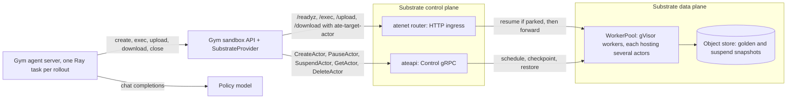
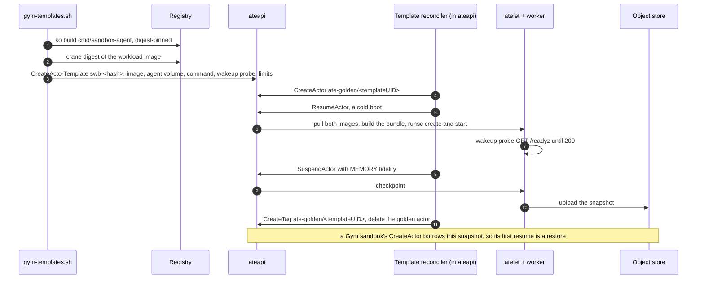
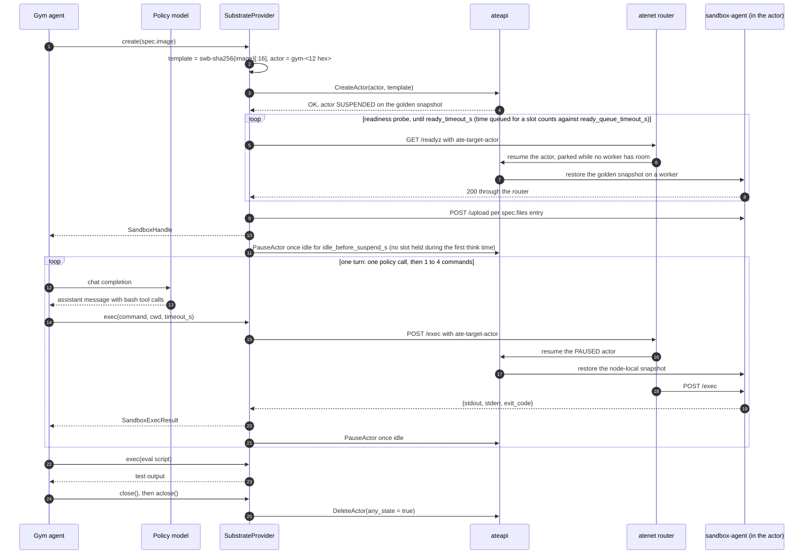
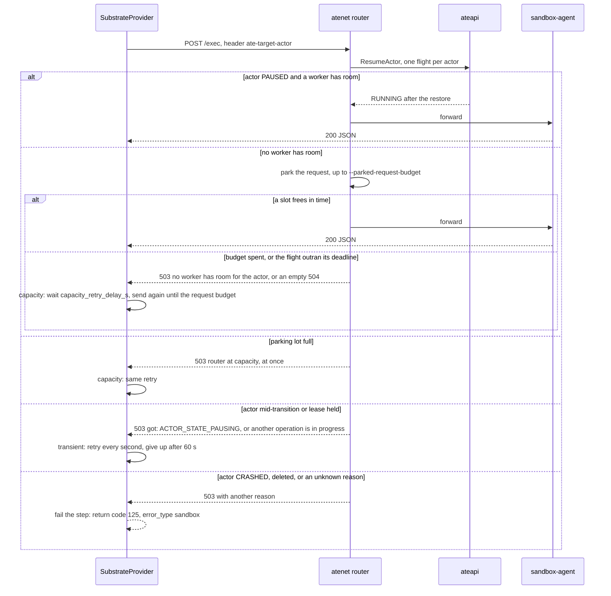
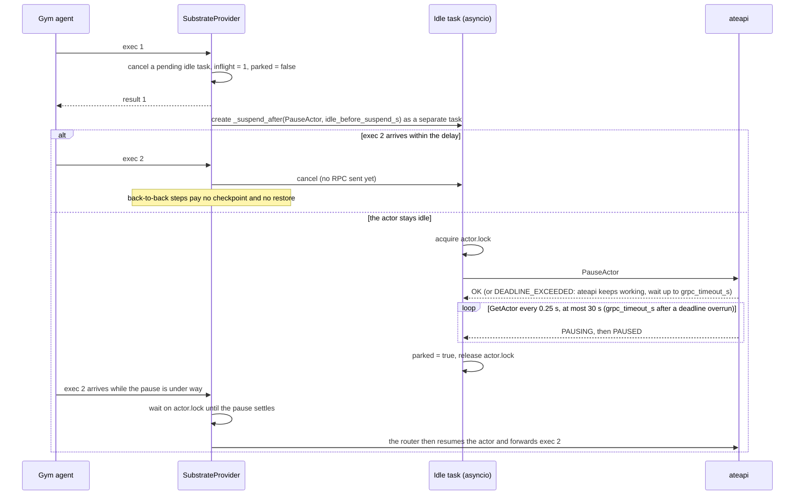
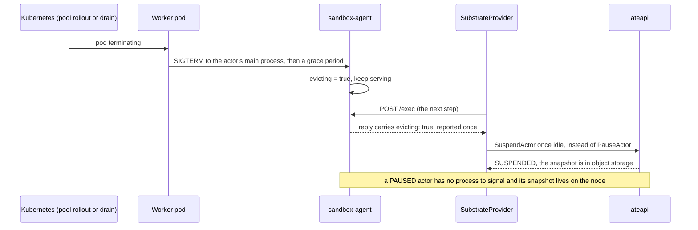
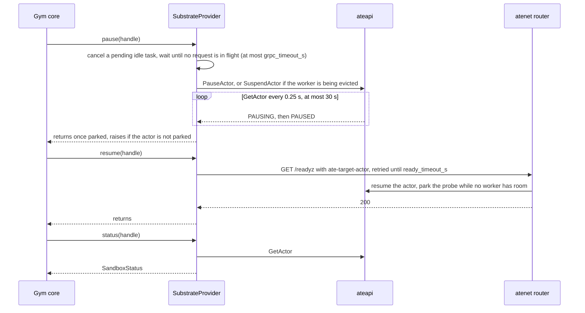
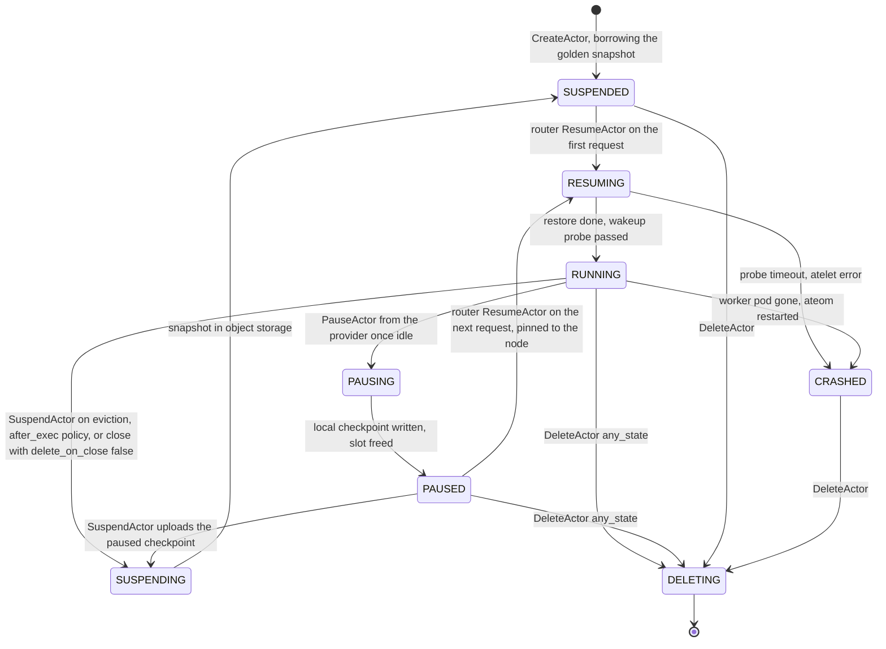

# Architecture: the seam between NeMo Gym and Substrate

What the two sides must agree on, how one rollout flows through them, and what the
provider does when something fails. Gym's own servers and Substrate's own components are
described in their repositories; this document covers only the pieces in this one: the
provider (`gym_substrate/`), the in-actor agent (`cmd/sandbox-agent`) and the template
generator (`hack/gym-templates.sh`). Diagrams are Mermaid; GitHub renders them inline.

## The idea

A coding-agent rollout spends most of its wall-clock waiting for the policy model. A
plain container sandbox holds its CPU and memory the whole time. Substrate runs each
sandbox as an *actor* that can be checkpointed and restored, and multiplexes many actors
onto a smaller set of ready *workers* (pods running gVisor). The provider turns every Gym
sandbox into an actor, pauses it once it has been idle for a second after a command, and
lets Substrate's router resume it on the next command. An idle sandbox then holds no
worker, so a pool carries more sandboxes than it has slots.

## System context

Two paths leave the provider. Control operations go to `ateapi` over gRPC with a
Kubernetes ServiceAccount token. Data operations (commands and files) go over HTTP to the
router, which reads the `ate-target-actor` header, resumes the actor if it is parked, and
forwards the request to the agent running inside the actor. The provider never calls
`ResumeActor` itself: the router does, and parks the request while no worker has room.

## The plugin seam

| Contract | Provider (`gym_substrate/provider.py`) | Cluster side |
|---|---|---|
| Template name | `template_name_for_image`: `swb-` + sha256(image without `docker://`, `oci://`, `docker.io/`)[:16]; pinned by a unit test for a SWE-bench image | `hack/gym-templates.sh` computes the same name with `shasum -a 256` and creates the `ActorTemplate` |
| Actor name | `gym-` + 12 hex of a UUID, one actor per Gym sandbox, in `connection.atespace` | any name is accepted |
| Routing | header `ate-target-actor: <atespace>/<actor>` on every request; the URL path selects the operation | the router reads the header; the agent serves on `PORT` 80 |
| Readiness | `GET /readyz` answers 200, `probe.stable_count` times in a row | `handleReadyz` answers as soon as the agent is up; the template's `wakeupProbe` uses the same path |
| Exec | `POST /exec` `{command, cwd, env, user, timeout_s}`; reply `{stdout, stderr, exit_code, error_type, evicting}`; exit code 125 with an `error_type` means the sandbox failed, not the command | `handleExec`: `bash -c` (else `sh`; `SANDBOX_SHELL` overrides), own process group killed whole on timeout, 8 MiB per stream, `user` must be `root`, `0` or unset (`docs/contract.md`) |
| Files | `POST /upload?path=` with the raw body; `GET /download?path=`; one whole file per request | `handleUpload`, `handleDownload` |
| Eviction | `evicting: true` on a reply marks the actor; the next idle park suspends to storage instead of pausing, then clears the mark | the agent records the worker's SIGTERM, keeps serving, reports it once |
| Status | `_STATUS_MAP` from `ActorState` to Gym's `SandboxStatus` (below) | the `ActorState` enum in `ateapi.proto` |
| Router 503 and 504 | `_classify_unavailable`: *capacity* (`no worker has room`, `router at capacity`, or a 504 with an empty body) retried every `capacity_retry_delay_s` until the request budget; *transient* (`got: ACTOR_STATE_PAUSING`, `SUSPENDING`, `RESUMING`, `REVERTING`, `please retry`, `another operation is in progress`, or a bare `actor <id> unavailable`) retried every second for at most 60 s; anything else fails the step | the router answers `actor <id> unavailable[: <reason>]` before forwarding, and an empty 504 when a resume flight outruns its deadline |
| Control RPCs | `CreateActor`, `GetActor`, `PauseActor`, `SuspendActor`, `DeleteActor(any_state=true)`; `ABORTED`, `UNAVAILABLE` and `INTERNAL` get five attempts with exponential backoff and jitter | the `Control` service of `ateapi` |
| Stubs | `gym_substrate/_ateapi/`, generated by `scripts/generate_ateapi_stubs.sh`; `SUBSTRATE_COMMIT` records the proto's commit | `pkg/proto/ateapipb/ateapi.proto` |

Declined rather than faked: `spec.resources` (actors are sized by the template),
`spec.ttl_s` (a paused actor costs almost nothing), `spec.entrypoint` (the container
command runs the agent), and any `user` other than `root`, `0` or unset.

### What the router does with a request

For every request the router parses `ate-target-actor` and calls `ResumeActor` through a
per-actor *flight* that concurrent requests for the same actor join; a `RUNNING` actor
costs one lease-less read. If no worker has room, the request is *parked*: the flight
retries `ResumeActor` with backoff for `--parked-request-budget`, then answers 503 `no
worker has room for the actor`. A request that arrives when `--parked-request-max` are
already parked gets 503 `router at capacity` at once. A flight that outruns its deadline
answers an empty 504. Once the actor runs, Envoy forwards the request to the worker pod
over mTLS and the worker's ingress proxy hands it to the agent on the actor's address.
Details: Substrate's [docs/request-parking.md](https://github.com/agent-substrate/substrate/blob/main/docs/request-parking.md).

## Sequences

### Template and golden snapshot

`hack/gym-templates.sh` runs once per image before a run and returns as soon as the
template exists. The reconciler inside `ateapi` then builds the golden snapshot on its
own; `kubectl ate get actor-template -a nemo-gym` shows the golden tag when it is done.

### One rollout, end to end

Within a policy turn the one to four commands arrive back to back, so the idle delay
keeps the actor warm between them and the pause lands once per turn.

The pause after a step is a background task: the exec reply reaches the agent first, and
the checkpoint happens while the policy model is thinking. `create()` ends with the same
park, so a new sandbox holds no worker through the policy's first think time and its
first command is a resume like any later one.

### One command against a paused actor

A 503 or 504 the router produced never reached the actor, so sending the request again is
safe. The exception is a reason that names a terminal state: nothing will make that actor
routable again, so the step fails at once. The request budget is the command timeout plus
30 s, so a command that times out inside the sandbox reports its own partial output
instead of the client giving up first.

### Pause after a step

Rules the code enforces:

- An actor is never paused while a request to it is in flight.
- A pause that has not reached the control plane is cancelled by a new request; one that
  has is left to finish, and the new request waits for it, because the router cannot
  resume an actor that is still `PAUSING`.
- The pause runs in its own task and a cancelled caller cannot cancel the RPC. A
  `PauseActor` cancelled client-side leaves the actor stranded `PAUSING` on a Substrate
  without [#2558](https://github.com/agent-substrate/substrate/pull/2558). A `PauseActor`
  that outruns the client deadline is waited out through `GetActor` instead of being
  failed or re-sent.
- A failed pause costs density, not correctness: the actor stays running and the next
  command still works. A park still mid-transition after 30 s is left to the control
  plane with a warning, and the next park retries.
- `aclose()` waits for every idle task and every background cleanup before closing the
  gRPC channel.

### Eviction of a worker

The agent keeps serving after SIGTERM because a process that exits cannot be suspended,
and only the client can ask for the suspend. The gap is the actor that is already paused
when the node goes: Substrate does not move it, so suspend every actor (`kubectl ate
suspend`) before a pool rollout or a node drain.

### pause() and resume() from Gym core

The provider implements `SupportsSandboxPauseResume`, so a training loop can park a
sandbox between turns without waiting for the idle timer.

## Actor states as the provider sees them

Every transition is a workflow in `ateapi` that holds the actor's lease; the provider
drives pause, suspend and delete, the router drives resume.

| ActorState | SandboxStatus | Why |
|---|---|---|
| RUNNING | RUNNING | |
| RESUMING, REVERTING | STARTING | a restore is under way |
| PAUSED, PAUSING, SUSPENDED, SUSPENDING | PAUSED | alive and one request away; the router resumes it |
| CRASHED | ERROR | |
| DELETING, or `GetActor` NOT_FOUND | STOPPED | |
| anything else, or `GetActor` failed | UNKNOWN | |

## Failure handling

| Failure | Where it shows | What happens |
|---|---|---|
| No template for the image | `CreateActor` NOT_FOUND | `SubstrateCreateError` naming the template and image |
| Pool full at create | probe parked, then 503 capacity or an empty 504 | the probe loop goes on; time queued counts against `ready_queue_timeout_s`, time probing against `ready_timeout_s`; then `SubstrateCreateVerificationError` and the actor is deleted |
| Delete after a failed create refused | `DeleteActor` ABORTED while the parked probe's resume flight holds the lease | retried in the background every 15 s for up to 15 min; `aclose()` waits for it |
| Pool full at a step | 503 `no worker has room` after the park, `router at capacity` at once, or an empty 504 | retried every `capacity_retry_delay_s` until the request budget (command timeout plus 30 s), then return code 125 |
| Actor mid-transition or lease held | 503 `got: ACTOR_STATE_PAUSING`, `another operation is in progress`, `please retry` | retried every second for 60 s, then return code 125 |
| Actor crashed or deleted | 503 with a terminal reason | the step fails at once: return code 125, `error_type` `sandbox` |
| Envoy breaker | 503 `overflow`, no actor reason | the step fails at once; raise `--extproc-max-requests` or desynchronize steps |
| Command timeout | the agent kills the process group | exit code 125, `error_type` `timeout`, partial output kept |
| Client-side HTTP timeout | httpx exception | return code 125, `error_type` `timeout` |
| `ateapi` restart, lease conflict, PostgreSQL out of connections | gRPC UNAVAILABLE, ABORTED, INTERNAL | five attempts with exponential backoff and jitter |
| Pause fails | `PauseActor` error | warning; the actor stays running; the next step works |
| Pause outruns the client deadline | `PauseActor` DEADLINE_EXCEEDED | the state is polled for up to `grpc_timeout_s`; the pause is not re-sent |
| Worker evicted while running | `evicting: true` on a reply | suspend to storage when idle, or in `pause()` |
| Worker evicted while paused | nothing: no process to signal | the snapshot goes with the node; suspend before rollouts |
| Agent process dies mid-rollout | nothing: Substrate has no TTL | the actors stay parked until deleted (`scripts/delete_actors.py`) |
| Command longer than the router's route timeout | 504 from Envoy with the command still running | set `--route-timeout` above the longest exec |

## Trust

`ateapi` rejects unauthenticated calls; the provider mints a ServiceAccount token and
reads the serving CA from the cluster (`docs/provider.md`, Authentication and trust). The
router's ingress port is unauthenticated and the agent runs whatever it is sent, as root:
anyone who can reach the router and knows `<atespace>/<actor>` can run commands in that
sandbox. Keep the router unexposed.

## Glossary

| Term | Meaning |
|---|---|
| Actor | One Substrate-managed application instance, here one Gym sandbox |
| Worker | A pod from a WorkerPool that hosts actors inside gVisor; capacity is the sum of its actors' template limits |
| Slot | Room on a worker for one actor of a given template size |
| Atespace | Substrate's namespace for actors and templates |
| ActorTemplate | Immutable spec an actor is created from: image, command, volumes, probe, limits, snapshot location |
| Golden snapshot | A snapshot of a template booted once and probed ready; a new actor starts from it, so its first start is a restore |
| Pause | Node-local checkpoint; frees the slot; the actor must resume on the same node |
| Suspend | Checkpoint uploaded to object storage; any node can resume it |
| Park | The router holding a request while no worker has room, up to `--parked-request-budget` |
| Flight | The router's one in-progress `ResumeActor` per actor that concurrent requests join |
| Lease | The row that serializes workflows on one actor; a second caller gets ABORTED |
| Step | One Gym `exec`; a policy turn produces one to four of them |
